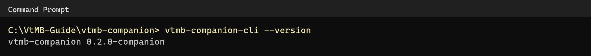
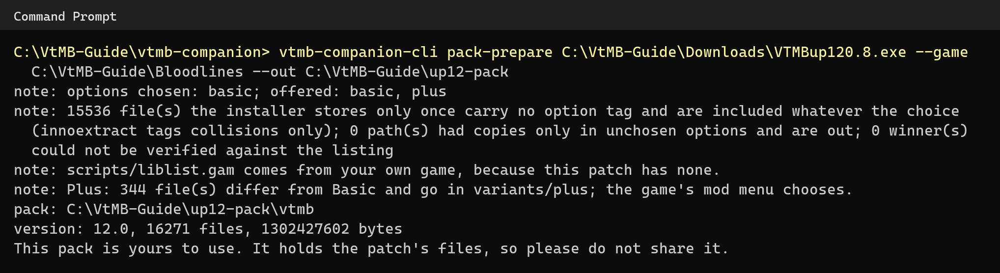
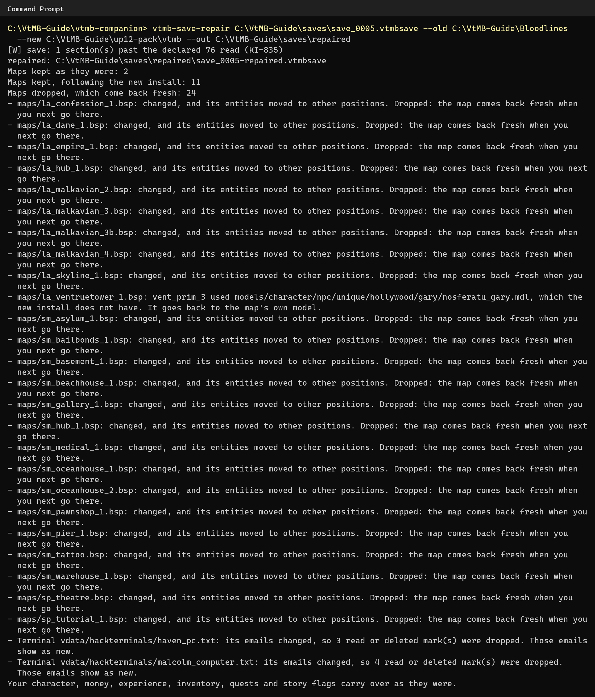

# Upgrading re:Source to Unofficial Patch 12.0

re:Source ships with the Unofficial Patch 11.5 pack. This guide makes a 12.0 pack from your own download of the
patch, puts it on your Quest, and brings your 11.5 saves across. It takes about 15 minutes.

The Unofficial Patch is by Werner Spahl (Wesp5). Download it from its [own page](https://www.moddb.com/mods/vtmb-unofficial-patch).

## What you need

- A Windows PC. Making the pack compiles the patch's scripts with your game's own Python, which only runs on Windows.
- Your own copy of Bloodlines from [Steam](https://store.steampowered.com/app/2600/) or
  [GOG](https://www.gog.com/en/game/vampire_the_masquerade_bloodlines), installed on that PC.
- The patch's installer, for example `VTMBup120.8.exe`. You do not need to run it.
- The re:Source Companion 0.2.0 or newer for Windows, `vtmb-companion-0-2-0-windows-x64.zip` from the
  [Companion release](https://github.com/alex-nax/resource/releases/tag/v0.2.0-companion), and re:Source 0.1.2 or newer
  on your Quest. The steps use the command-line tools that come in the Companion's zip.
- About 3 GB of free disk, [SideQuest](https://sidequestvr.com/setup-howto), and the USB cable you installed the game with.

The examples below keep everything in one folder, `C:\VtMB-Guide`. Use your own folders instead; only the names
change.

## 1. Unpack the Companion

Unzip the Companion and open a Command Prompt in its folder (type `cmd` in the folder's address bar). Check that it
runs with `vtmb-companion-cli --version`:



Your version may be newer than the one shown.

## 2. Make the 12.0 pack

```
vtmb-companion-cli pack-prepare <the patch's installer> --game <your game folder> --out <a new folder>
```

- `<the patch's installer>` is the file you downloaded.
- `<your game folder>` holds the game's `Vampire` and `Bin` folders, for example
  `C:\GOG Games\Vampire - The Masquerade - Bloodlines` or
  `C:\Program Files (x86)\Steam\steamapps\common\Vampire The Masquerade - Bloodlines`.
- `<a new folder>` is where the pack is written.

It takes a few minutes (about six on the PC this guide was made on) and writes a 1.3 GB pack.



What the output tells you:

- **options chosen: basic** and **Plus: 344 file(s) differ from Basic.** The pack holds both versions of the patch, as
  the released 11.5 pack does. Its main folder is Basic. What Plus changes goes in `variants/plus`. You choose between
  them in the game's mod menu (Plus is the default); a change takes a restart and a new game.
- **scripts/liblist.gam comes from your own game.** 12.0 does not ship one, so the game's own is used.
- **pack:** the folder to copy to the headset, here `C:\VtMB-Guide\up12-pack\vtmb`.
- **This pack is yours to use.** It holds the patch's files, so please do not share it.

The pack also carries what the game needs from your own `vampire.dll` and `client.dll` (the NPC schedules and the
computer screens' font), read as data. No DLL is copied.

## 3. Put the pack on your Quest

Connect the headset by USB and close the game. Then either run:

```
vtmb-companion-cli pack-install --from <the folder after "pack:" above>
```

Type `--from` and the folder exactly: without `--from`, `pack-install` downloads and installs the published 11.5 pack
instead.

Or copy it by hand: in SideQuest's file manager open `/sdcard/vtmb` and copy the contents of the pack's `vtmb` folder
into it, replacing when asked. Either way, nothing on the headset is deleted and your saves stay where they are.

**Before you play:** a save made on 11.5 will not load on 12.0, because the patch changed its maps. Start a new game,
as the patch's own readme recommends, or repair your saves first (step 4).

## 4. Bring your saves across

1. **Copy your saves to the PC.** In SideQuest's file manager open `/sdcard/vtmb/saves/campaigns`, then the folder of
   the patch you played, such as `unofficial_patch-plus-11.5`, and copy the `.vtmbsave` files you want, for example
   into `C:\VtMB-Guide\saves`.
2. **Have the 11.5 files at hand.** The repair compares the two patch versions, so it needs both. The 11.5 one is
   either your game folder (when the 11.5 patch is installed in it) or the 11.5 pack you installed before: unzip it
   and use its `vtmb` folder. The 12.0 one is the pack's `vtmb` folder from step 2.
3. **Repair each save:**

   ```
   vtmb-save-repair <the save> --old <the 11.5 files> --new <the 12.0 pack folder> --out <a folder>
   ```

   `vtmb-save-repair` sits beside the Companion. It takes a few seconds and never changes your original. It writes
   `<name>-repaired.vtmbsave` and `<name>-repaired.report.txt` into the `--out` folder. A line starting with `[W]` is
   a note about the save file, not an error.

   

4. **Copy the repaired save back** into `/sdcard/vtmb/saves` with SideQuest. Keep the original as well.

Reading the report:

- **Maps kept as they were:** unchanged in 12.0, so everything you did there stays.
- **Maps kept, following the new install:** changed, but every entity is where it was, so your progress there stays.
- **Maps dropped:** changed too much to carry over safely. They come back as on a first visit, so items you took or
  doors you opened there are back.
- **The map you are on:** if it changed, it starts fresh too, and if its walls moved you start at the map's arrival
  point.
- **Terminal emails:** where a computer's emails changed, those you had read show as new.
- **Your character, money, experience, inventory, quests and story flags** always carry over.

Save repair is new and has seen few saves, so keep your original. A pack you make from 12.0 has had less testing than
the 11.5 pack published with the game; please report what you find with the in-game reporting tool.

## If something goes wrong

- **"This patch does not say which version it is."** Name it yourself: add `--version 12.0` to `pack-prepare`.
- **"no readable schedule bodies (a packed DLL?)"** Your game's `vampire.dll` is the copy-protected 1.2 build. Install
  the game from Steam or GOG, whose builds can be read.
- **"it needs an Unofficial_Patch/maps folder"** (save repair). One of `--old` or `--new` is not a patch folder: point
  it at the folder that holds `Unofficial_Patch`.
- **The game says "Pack update required".** The pack did not copy completely. Copy it again; nothing needs deleting.

See [the Companion guide](COMPANION.md) for the rest of what the Companion does.
